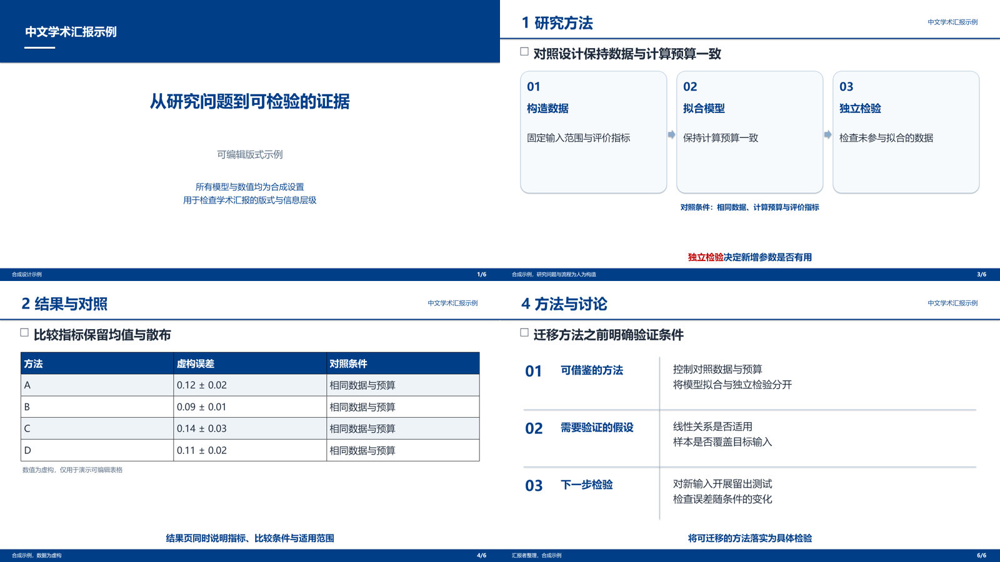

# Zotero Journal Club

[中文](README.md) | English

Project: [Leestars21/zotero-journal-club](https://github.com/Leestars21/zotero-journal-club)

Create editable Chinese journal-club presentations from a Zotero paper or local PDF, using reading notes and annotations to organize the problem, method, evidence and concrete lessons. Reuse existing text extraction, obtain original figures from the selected PDF attachment, and respect the user's PowerPoint template. Deliver the PPTX, speaker notes, paper analysis, source mapping and QA.

## Install and requirements

Ask Codex to install it:

```text
Install the zotero-journal-club Skill from https://github.com/Leestars21/zotero-journal-club.
```

Alternatively, download the repository and copy its `zotero-journal-club/` subdirectory to `~/.codex/skills/zotero-journal-club/` (Windows: `%USERPROFILE%\.codex\skills\zotero-journal-club\`). Start a new session and invoke `$zotero-journal-club`.

Codex and presentation authoring tools are required. The build and validation scripts need Python 3, `python-pptx` and Pillow; the PDF inspection helper needs PyMuPDF. Zotero access requires a suitable read-only interface, with a local PDF as fallback. PowerPoint or an existing artifact-tool runtime can render previews; their display may differ. No additional paid model API is required.

## Usage

```text
$zotero-journal-club Prepare a 15-minute Chinese group presentation on the paper in Zotero titled ...
$zotero-journal-club Prepare a talk from this local PDF using my PPTX template.
```

DOIs, item keys and links are also accepted. Supply a template in the request or configure `default_template` in `~/.codex/zotero-journal-club.json` using the [example](zotero-journal-club/config.example.json). `ZOTERO_JOURNAL_CLUB_CONFIG` selects another configuration file. Explicit templates take precedence, and missing selected files cause an error. Codex performs the research and verification; scripts do not understand papers. The optional builder fills placeholders or explicitly specified regions on a custom layout after inspection. It retains theme and masters; complex templates need manual adjustment and visual review. Automated checks cannot establish accuracy or catch every overflow.

Existing notes and annotations guide reading questions, which are checked against the paper and placed in method explanations, result interpretation or discussion. AI-generated notes also require verification. Prefer Zotero's figure interface for key images; when it returns no crop and the local PDF is readable, crop an inspected page region. A parent-only MinerU cache match does not verify the specific PDF attachment. Journal metrics are optional so the talk can focus on method and results.

## Finished layouts and visual references

Inspect a user-supplied finished deck before designing a journal-club talk, then use its level of visual finish as the benchmark. Set `quality_reference` in the local configuration above to retain that expectation for later talks. It is independent of `default_template`, and a task may override either separately. Keep reference files, private screenshots and papers local.

The bundled `academic-blue` design supports cover/outline pages, chapter and local headings, figure/text panels, numbered synthesis rows, native method diagrams, equation explanations, tables and concise takeaways. It uses blue hierarchy and restrained red emphasis, allocating space according to content. See the [visual quality contract](zotero-journal-club/references/visual-quality.md). Finished delivery requires rendering every page and comparing hierarchy, captions, legibility and details against the reference; automated checks are one part of that process.

This public preview contains only synthetic material:



Generate it from the repository root:

```text
python -X utf8 zotero-journal-club/scripts/build_ppt.py examples/academic-blue-plan.json output/academic-demo/presentation.pptx
python -X utf8 zotero-journal-club/scripts/validate_ppt.py output/academic-demo/presentation.pptx --plan examples/academic-blue-plan.json --evidence examples/research-evidence.json
```

## Build and evidence checks

The helper supports default columns, captioned multi-image pages, native editable tables and process diagrams, and simple equations with variable explanations. Preserve checked original images for complex mathematics. Reading questions, figure explanations, transferable methods and durations can be recorded in the plan and appended to speaker notes. See the [slide-plan contract](zotero-journal-club/references/slide-plan.md) for fields and template content regions.

Run this synthetic example from the repository root; its data is explicitly fictional and tests editing and source bindings:

```text
python -X utf8 zotero-journal-club/scripts/build_ppt.py examples/research-plan.json output/demo/presentation.pptx
python -X utf8 zotero-journal-club/scripts/validate_ppt.py output/demo/presentation.pptx --plan examples/research-plan.json --evidence examples/research-evidence.json
```

Keep `slide_plan.json` and `evidence.json` with real talks. The validator compares actual text, columns, notes, table data and image bytes, and checks source IDs, pages and claim destinations. Structural and evidence-binding checks report their own completion states. Missing source labels are errors. Text-fit and image-resolution warnings still require rendering and visual review.

For local original figures, use `python -X utf8 zotero-journal-club/scripts/extract_figures.py source.pdf regions.json assets/ --dpi 220` with coordinates from inspected source pages; it writes images and provenance. Build/crop helpers refuse existing outputs. Keep full papers, private notes, caches and generated validation talks in ignored `output/`; see the public [QA record](examples/qa_report.en.md) for validation coverage.

On Windows, if the existing Office preview helper fails when hiding PowerPoint, `zotero-journal-club/scripts/render_powerpoint.ps1` exports a native PDF for page previews. It opens the input read-only and preserves an already-running app and existing output. See [quality control](zotero-journal-club/references/quality.md).

## Directory and artifact management

- `zotero-journal-club/`: the installable skill, scripts and reference guidance; retain this directory level.
- `examples/`: maintained synthetic plans, a public preview and QA records.
- `tests/`: regression tests; use the skill's `scripts/render_preview.mjs` for previews.
- `output/<paper-id>/`: local final PPTX, analysis, sources, QA, `assets/` and one `preview/` set; excluded from pushes.

Use one output directory per paper and place temporary scripts, drafts and repeated renders in its `.work/` directory. After verifying the final files, remove the current task's intermediate versions while retaining the deliverable, required assets and evidence records. Archive useful development notes in `output/archive/`; keep the root for project documentation, the license and repository rules. Preserve the user's original papers and reference presentations in their original locations.

## Validation and feedback

Run `python -X utf8 -m unittest discover -s tests` and the Codex `quick_validate.py` skill validator. UTF-8 mode is recommended on Windows. Report problems through [GitHub issues](https://github.com/Leestars21/zotero-journal-club/issues), including the input type, OS, error and expected behavior; do not publish private notes, full papers or Zotero databases.

## License

See [LICENSE](LICENSE).
