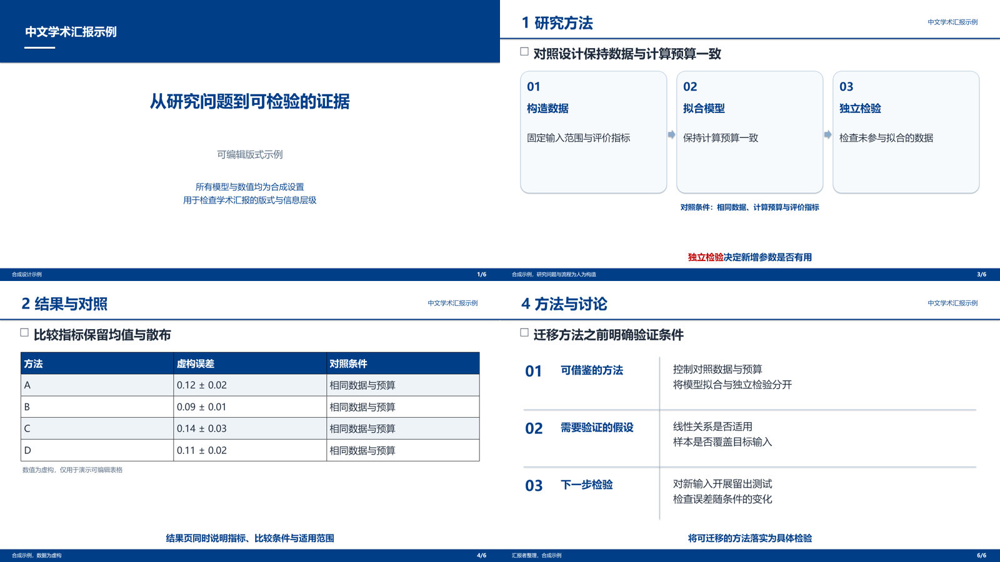

# Zotero Journal Club

中文 | [English](README.en.md)

项目主页：[Leestars21/zotero-journal-club](https://github.com/Leestars21/zotero-journal-club)

将 Zotero 文献或本地 PDF 整理为中文组会汇报，结合阅读笔记与批注，围绕论文问题、方法、证据和具体收获组织内容。复用已有文本解析，从指定 PDF 附件获取原图，支持用户 PPT 模板，输出可编辑 PPTX、逐页讲稿、论文分析、来源清单和质量报告。

## 安装和依赖

可以直接让 Codex 安装：

```text
请从 https://github.com/Leestars21/zotero-journal-club 安装 zotero-journal-club Skill。
```

也可以下载仓库，将其中的 `zotero-journal-club/` 子目录复制到 `~/.codex/skills/zotero-journal-club/`（Windows：`%USERPROFILE%\.codex\skills\zotero-journal-club\`）。在新会话中使用 `$zotero-journal-club`。

需要 Codex 和可用的 PPT 制作工具；附带的生成与结构检查脚本需要 Python 3、`python-pptx` 和 Pillow，PDF 读取辅助脚本需要 PyMuPDF。从 Zotero 直接读取需要可用的 Zotero MCP 或本地只读接口；不可用时可提供 PDF。逐页渲染可使用 PowerPoint 或现有 artifact-tool 运行时；两者显示效果可能有差异。无需额外付费模型 API。

## 使用

```text
$zotero-journal-club 帮我汇报 Zotero 中的《论文标题》，制作 15 分钟中文组会 PPT。
$zotero-journal-club 根据这份本地 PDF 制作汇报，使用我提供的 PPTX 模板。
```

也可以提供 DOI、Zotero 条目 key 或链接。默认模板可在任务中指定，也可在 `~/.codex/zotero-journal-club.json` 设置 `default_template`；配置格式见 [示例](zotero-journal-club/config.example.json)。设置环境变量 `ZOTERO_JOURNAL_CLUB_CONFIG` 可使用其他配置文件。任务中指定的模板优先；指定的文件不存在时会报错。报告内容由当前 Codex 会话分析与核验，脚本不会自动理解论文。模板生成辅助器可使用版式占位符；对无占位符的版式，需要先检查模板并指定内容区域。母版和主题保留，复杂模板需要人工调整和视觉检查。自动检查不能证明学术结论正确，也不能完整检测文字溢出。

已有笔记和批注会作为阅读问题的线索，再对照原文整理到方法讲解、结果解读或讨论页；AI 生成的笔记也需核验。关键图像优先通过 Zotero 图像接口获取，未返回图像且本地 PDF 可读时，可按已检查的页码与位置裁切。只匹配到父文献的 MinerU 缓存不视为具体 PDF 附件已确认。影响因子和分区按需查询，默认将汇报时间留给方法与结果。

## 成品版式与视觉基准

制作组会汇报时，先查看用户提供的成品 PPT，再按其视觉完成度组织新内容。可在上述本机配置中设置 `quality_reference`，作为后续汇报的长期视觉基准；它与 `default_template` 分别设置，任务中可单独覆盖。参考文件只作本地视觉依据，库中的论文、参考汇报与私人截图保留在本地。

附带 `academic-blue` 学术版式，支持封面、目录、章节与本页标题、图文分栏、编号总结行、方法流程、公式说明、表格和逐页结论。它采用蓝色层级与少量红色强调，按内容分配图文区域。完整质量标准见[视觉质量说明](zotero-journal-club/references/visual-quality.md)。成品交付需要逐页渲染，并对照参考检查层级、图注、可读性和细节；自动检查通过只是其中一部分。

下面的公开预览全部为合成内容：



可在仓库目录生成该示例：

```text
python -X utf8 zotero-journal-club/scripts/build_ppt.py examples/academic-blue-plan.json output/academic-demo/presentation.pptx
python -X utf8 zotero-journal-club/scripts/validate_ppt.py output/academic-demo/presentation.pptx --plan examples/academic-blue-plan.json --evidence examples/research-evidence.json
```

## 生成与证据检查

附带辅助器支持默认双栏、带独立图注的多图页、可编辑表格和流程图，以及简单公式与变量说明。复杂公式保留经核对的原图。逐页计划可记录阅读疑问、读图提示、可迁移方法与时长；这些内容写入讲稿备注。字段和模板内容区域见 [逐页计划说明](zotero-journal-club/references/slide-plan.md)。

在仓库目录运行以下合成示例；数据明确为虚构，用于验证对象编辑与证据关联：

```text
python -X utf8 zotero-journal-club/scripts/build_ppt.py examples/research-plan.json output/demo/presentation.pptx
python -X utf8 zotero-journal-club/scripts/validate_ppt.py output/demo/presentation.pptx --plan examples/research-plan.json --evidence examples/research-evidence.json
```

实际汇报建议保留 `slide_plan.json` 和 `evidence.json`。检查器会比对实际文字、双栏、备注、表格数据和图像内容，检查来源标识、页码与结论所在页的关联；结构检查和证据关联检查的完成状态分别记录。缺失来源标注会报错。文字适配和图像清晰度提示仍需逐页渲染复核。

本地原图裁切可使用 `python -X utf8 zotero-journal-club/scripts/extract_figures.py source.pdf regions.json assets/ --dpi 220`；坐标必须来自已检查的原 PDF 页面，输出包含图像与来源记录。生成器和裁切器拒绝覆盖已有成果。完整论文、私人笔记、缓存和成品测试稿留在已忽略的 `output/` 中；公开验证范围见 [质量记录](examples/qa_report.md)。

Windows 上若现有 Office 渲染助手因隐藏 PowerPoint 窗口失败，可用 `zotero-journal-club/scripts/render_powerpoint.ps1` 将 PPTX 原生导出为 PDF，再逐页预览。它只读打开输入，保留已运行的 PowerPoint 和已有输出；详情见 [质量检查](zotero-journal-club/references/quality.md)。

## 验证与反馈

运行 `python -X utf8 -m unittest discover -s tests`，并使用 Codex 自带的 `quick_validate.py` 检查技能。Windows 上建议启用 Python UTF-8 模式。遇到问题可在[项目议题](https://github.com/Leestars21/zotero-journal-club/issues)反馈输入类型、操作系统、错误与预期，勿公开私人笔记、完整论文或 Zotero 数据库。

## 许可证

见 [LICENSE](LICENSE)。
